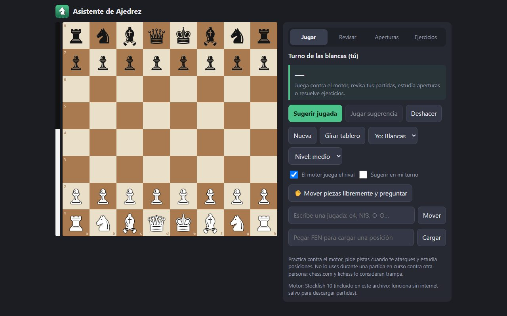

# Asistente de Ajedrez

Aplicación web para **practicar y analizar** ajedrez. Funciona en PC y teléfono, sin internet, en un solo archivo HTML.

**[▶ Probar la app](https://johanbentancor.github.io/ajedrez/ajedrez.html)**



## Qué hace
- **Jugar** contra el motor en varios niveles, con sugerencias de jugada y la opción de deshacer.
- **Revisar partidas terminadas** de chess.com (por usuario), de lichess (por enlace) o pegando un PGN. Marca imprecisiones, errores y errores graves, y calcula la precisión de cada jugada.
- **Aperturas:** 10 aperturas con consejos jugada a jugada y simulación de cómo sigue cada una.
- **Ejercicios** comprobados por el motor y un **editor de posiciones**: mueves las piezas libremente y preguntas cómo jugarían las blancas o las negras.

> Es para practicar y estudiar. No está pensado para usarlo durante una partida en curso contra otra persona: chess.com y lichess lo consideran trampa.

## Cómo está hecho
- **Motor Stockfish** (versión asm.js) corriendo en un **Web Worker**, comunicado por el protocolo UCI, para analizar sin congelar la página.
- **chess.js** para las reglas y la notación.
- **APIs REST** de chess.com y lichess para descargar partidas.
- Interfaz en HTML, CSS y JavaScript sin frameworks, adaptable a teléfono.
- Un script en **Python** (`build.py`) une la plantilla, el motor y las librerías en un único `ajedrez.html`. `make_logo.py` genera el logo con Pillow.

## Estructura
```
src/app.template.html   Código de la aplicación (HTML + CSS + JS)
src/stockfish.min.js    Motor Stockfish 10 (asm.js)
src/chess.min.js        chess.js 0.10.3
assets/                 Logo e íconos
build.py                Genera ajedrez.html
make_logo.py            Genera el logo
```

Para regenerar la app: `python build.py`

## Créditos y licencias
- [Stockfish](https://stockfishchess.org/): GPLv3.
- [stockfish.js](https://github.com/nmrugg/stockfish.js): el port a JavaScript.
- [chess.js](https://github.com/jhlywa/chess.js): licencia BSD-2-Clause.
